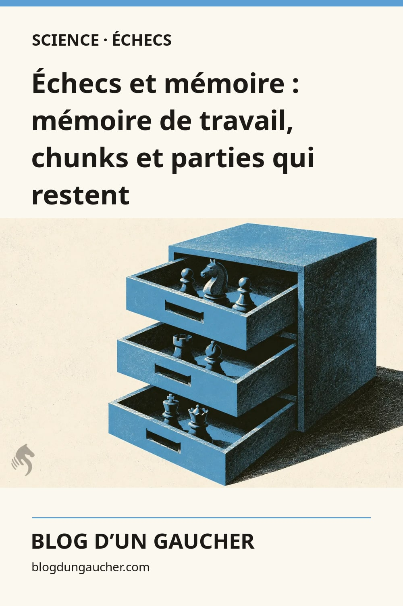

# Publication Pinterest en français

Trois flux RSS 2.0 indépendants alimentent les tableaux Science, Esprit et Société.
Les flux contiennent immédiatement **un article réel par rubrique** pour permettre
leur enregistrement dans Pinterest. Les trois articles d’initialisation comptent
pour la semaine du 27 octobre. Les nouveautés et le reste du stock suivent ensuite
le calendrier de publication.

## Connexion dans Pinterest après fusion et déploiement

Le compte doit être professionnel et `blogdungaucher.com` doit y être revendiqué.
L’installation de la balise ne confirme pas à elle seule que Pinterest a validé la revendication.

Depuis Pinterest sur ordinateur, ouvrir les paramètres de création/importation
en masse, puis connecter chaque flux au tableau public correspondant :

| Flux | Tableau proposé |
| --- | --- |
| `https://blogdungaucher.com/pinterest/science.xml` | Science des échecs |
| `https://blogdungaucher.com/pinterest/esprit.xml` | Psychologie et esprit du joueur d’échecs |
| `https://blogdungaucher.com/pinterest/societe.xml` | Les échecs dans la société |

Le raccordement au compte Pinterest reste manuel. Aucun jeton Pinterest, service
externe ou abonnement supplémentaire n’est nécessaire pour produire les flux.
Les horaires ci-dessous concernent **l’entrée dans le flux** : Pinterest annonce
un délai d’importation pouvant aller jusqu’à 24 heures, et ne garantit pas une
heure de publication précise. Vérifier les premières épingles dans chaque tableau.

Documentation : https://help.pinterest.com/en/business/article/auto-publish-pins-from-your-rss-feed

## Calendrier de départ

- Initialisation : **27 octobre 2026 à 10 h, heure de Guadeloupe** (14 h UTC),
  avec mémoire (Science), psychologie du joueur (Esprit) et argent (Société).
  Chaque flux contient donc un élément dès le déploiement de cette correction.
- Reprise régulière : **3 novembre 2026 à 10 h en Guadeloupe** (14 h UTC).
- Anciens articles : mardi, vendredi et dimanche à la même heure.
- Stock initial : **72 articles**, figés dans `scripts/pinterest/archive.json` :
  trois à l’initialisation, puis 69 sur 23 semaines jusqu’au 11 avril 2027.
  Le seuil séparant stock et nouveautés est `2026-10-28T00:00:00Z`.
- Première semaine régulière : Alzheimer le 3 novembre, habitudes le 6 novembre,
  triche le 8 novembre. Les articles d’initialisation ne sont pas replanifiés.
  La rotation commence par Science, Esprit et Société ;
  lorsqu’une rubrique épuise son stock, les autres utilisent les créneaux restants.
- Les nouveaux articles admissibles parus entre le seuil et le lancement entrent
  au lancement ; les suivants entrent après leur date de publication réelle.
- Pinterest refuse l’enregistrement d’un flux vide. Les trois articles
  d’initialisation servent précisément à rendre les flux connectables avant
  le début du calendrier régulier, avec leurs vrais liens et visuels.

Le workflow de publication existant reçoit les trois déclenchements de rebuild
à 14 h UTC. Son mécanisme reste le même : commit de trigger, détection par le VPS,
puis build. Les reconstructions quotidiennes existantes servent de rattrapage.
Aucun email ni notification n’est envoyé par le générateur Pinterest.

## Retards et reprise

Les flux ne contiennent que les entrées des **14 derniers jours**. Cela limite
une première connexion tardive à six anciens articles au maximum, plutôt qu’à
tout le catalogue. Une même URL d’article conserve son GUID et ne reçoit jamais
un nouvel identifiant simplement parce qu’un build ou un titre change.

Cette fenêtre implique un compromis explicite : une absence de consultation de
plus de 14 jours peut laisser passer des articles. Une connexion tardive ne
rejoue pas automatiquement les anciens créneaux expirés. Pour les reprendre,
modifier leurs dates dans le calendrier par PR, sur des créneaux libres à venir,
en conservant le plafond de trois par semaine. Ne pas replanifier un article
sans vérifier dans Pinterest s’il a déjà été publié. Aucun accusé de réception
Pinterest n’est disponible dans ce mécanisme RSS.

`/pinterest/status.json` donne les éléments **exposés aux flux**, leurs dates et
les compteurs du calendrier. Ce fichier ne prétend jamais confirmer la publication
d’une épingle. Il signale aussi les anciens articles ajoutés au dépôt sans créneau.

Si les flux ne sont pas raccordés dans la période prévue, revoir la date de départ
et décaler les créneaux concernés avant activation. Le calendrier est volontairement
versionné : aucune réorganisation automatique des anciens slugs à chaque build.

## Images et contenu

Les cartes sont des JPEG **1 000 × 1 500**, construits automatiquement avec Sharp.
Chaque article conserve sa couverture, ses métadonnées, son URL et son texte.
La carte Pinterest est un dérivé séparé : titre français, accent de rubrique,
illustration entière sans recadrage, filigrane existant conservé et signature du blog.
Les titres de carte et d’épingle reprennent le titre de l’article, limité à 100
caractères à une frontière de mot ; les descriptions utilisent le descriptif SEO
ou l’extrait existant. Aucun argument ou résultat scientifique n’est inventé.

Les images tierces nécessitent un crédit et une licence ; ces informations sont
conservées sur la carte et, avec le lien source, dans la description RSS.
Les images d’articles programmés, brouillons, hors rubrique ou `noindex` ne sont
pas générées avant leur admissibilité. Les images des articles toujours publics
restent disponibles même après la sortie de leur entrée de la fenêtre RSS.

Chaque élément fournit une seule image `media:content` et un lien vers le domaine
revendiqué avec des paramètres UTM. Le GUID reste l’URL canonique sans suivi.

Aperçus de la première semaine, non utilisés comme couvertures du site :

| Science | Esprit | Société |
| --- | --- | --- |
|  |  |  |

## Vérifications et maintenance

`npm run build` génère les cartes et les flux **avant Astro**, puis contrôle les
XML, les catégories, les GUID, les dates, les liens vers les pages réellement
construites et le format de chaque JPEG. Les fichiers dans `public/pinterest/`
sont générés et ignorés par Git ; ils sont copiés dans `dist/` par Astro.

```sh
npm test
npm run check
npm run build
npm run check:pinterest-preview
```

L’aperçu daté du 8 novembre est isolé dans `work/pinterest-preview/`, jamais dans
les fichiers destinés à la production. Les tests couvrent les frontières de dates,
les brouillons, les catégories, les doublons, le retard de connexion, l’échappement
XML et la préservation des illustrations. La CI construit également le site à
cette date pour contrôler les liens et images réellement exposés après lancement.

Aucun changement nginx ou proxy n’est requis pour ces trois fichiers statiques.
Le serveur doit continuer à récupérer `main` et reconstruire le site aux horaires
programmés. Une fusion seule ne connecte pas les flux au compte Pinterest.
